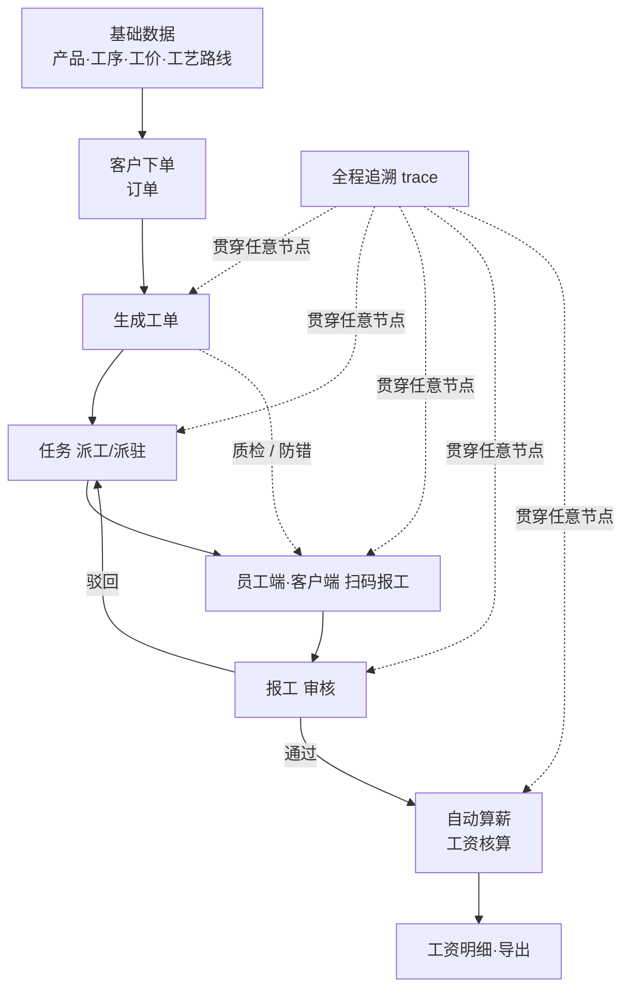
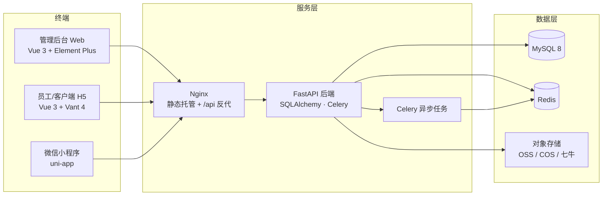

# CenkorMES

> 轻量化的单租户**私有部署 MES** —— 聚焦中小型加工厂的核心生产管理闭环。
> 基于开源的制造执行系统重构，强调开箱即用、安全可控、多端协同。

[](LICENSE)
[](backend/requirements.txt)
[](#)
[](#)
[](#)
[](#)

---

## 为什么选择 CenkorMES

- **一条命令开箱即用**：`docker compose up -d --build` 拉起 后端 + MySQL 8 + Redis + 管理后台 + 员工 H5，前端内置 Nginx 自动 `/api` 反代。
- **核心生产闭环完整**：排产 / 工单 / 派工 / 扫码报工 / 质检 / 自动算薪 / 全程追溯，交付即用。
- **多端协同**：PC 管理后台、员工与客户端 H5、微信小程序，扫码报工即得。
- **安全合规打磨**：登录失败限流（Redis 可回退）、上传文件类型与活动内容检测、日志脱敏、生产环境 JWT 强密钥校验。
- **私有部署可控**：单租户，数据完全自持；支持 Docker、手动、宝塔/ Nginx 多种部署；可导出离线安装包、跨架构构建。

---

## 核心业务闭环

```
产品/型号 → 工序/工价 → 客户/订单 → 工单 → 任务派驻 → 扫码报工 → 审核 → 自动算薪
```



---

## 系统架构



---

## 技术栈

| 层 | 技术 |
|----|------|
| 后端 | FastAPI · SQLAlchemy · Celery · Pydantic · Alembic |
| 数据库 / 缓存 | MySQL 8 · Redis |
| PC 管理后台 | Vue 3 · Element Plus · Pinia · ECharts · bpmn-js |
| 移动端 H5 | Vue 3 · Vant 4 |
| 小程序 | uni-app |
| 智能化 / 排产 | Google OR-Tools · Prophet · scikit-learn · OpenAI SDK |
| 部署 | Docker Compose · Nginx · Buildx（多架构） |

---

## 快速开始

### 环境要求

| 方式 | 依赖 |
|------|------|
| Docker 部署 | Docker 20+ / Compose v2 |
| 手动部署 | Python 3.10+ · Node.js 18+ · MySQL 5.7+/8.x，Redis（可选） |

### 方式一：Docker 一键启动（推荐，开箱即用）

```bash
docker compose up -d --build
```

- 首启自动建表并创建默认管理员 `admin / admin123`。
- 未设置 `JWT_SECRET` 时自动生成临时随机密钥保证一键可起；**正式部署请在仓库根 `.env` 配置固定强密钥**（≥32 位）。
- 访问地址（可在仓库根 `.env` 覆盖端口 `APP_PORT` / `WEB_ADMIN_PORT` / `WEB_H5_PORT`）：

| 服务 | 地址 |
|------|------|
| 后端 API（含 `/docs`） | `http://localhost:8000` |
| 管理后台 | `http://localhost:8080` |
| 员工 H5 | `http://localhost:8081` |

注入完整演示数据（可选、幂等，可重复执行）：

```bash
bash docker/scripts/init-demo.sh
```

### 方式二：手动启动

**1) 后端**

```bash
cd backend
python -m venv venv && source venv/bin/activate
pip install -r requirements.txt
cp env.example .env        # 编辑 DB_URL 与 JWT_SECRET
uvicorn app.main:app --host 0.0.0.0 --port 8000 --reload
```

**2) PC 管理后台**

```bash
cd frontend-admin-pro
npm install
npm run dev -- --port 5174   # 访问 http://localhost:5174
```

**3) H5 移动端**

```bash
cd frontend-h5
npm install
npm run dev -- --port 5173   # 访问 http://localhost:5173
```

> vite 开发代理默认将 `/api` 转发到 `127.0.0.1:8000`；可用 `VITE_API_PROXY` 指定其它后端地址（如本机 8000 被占用时），`./start.sh` 会自动跟随后端端口。

### 方式三：一条命令（本地开发 / 演示）

```bash
./start.sh                          # dev：后端 :8000 + 管理后台 :5174 + H5 :5173
./start.sh --prod                   # prod：后端无热重载，前端 build 后 preview 托管
BACKEND_PORT=8500 ./start.sh        # 后端端口被占用时，前端自动跟随
```

---

## 绑定域名与 HTTPS（Docker 部署 · 可选）

容器内 nginx 已内置「静态托管 + `/api` 反代」，默认通过 `IP:端口`（`8080` 管理后台 / `8081` H5 / `8000` API）访问。要对外使用**域名 + HTTPS**，在后端默认**不校验 Host** 的前提下，只需在宿主机加一层**入口代理**把域名转发到对应端口即可：

- **宝塔面板**：DNS 把两个子域名 A 记录指向服务器 IP → 添加两个站点绑定域名 → 各自在「反向代理」填 `http://127.0.0.1:8080`（管理后台）/ `http://127.0.0.1:8081`（H5）→ 站点 SSL 申请 Let's Encrypt 证书并强制 HTTPS。
- **系统 Nginx**：反代到 `127.0.0.1:8080 / 8081`，用 `certbot --nginx` 自动签发证书。
- 若在 `.env` 配置了 `TRUSTED_HOSTS`（Host 白名单），务必把域名加入，否则访问会被 403 拦截。
- 需要后端识别 HTTPS（避免生成 `http://` 链接）时，在入口反代追加 `proxy_set_header X-Forwarded-Proto https;`，并将 `PUBLIC_BASE_URL` / `H5_PUBLIC_BASE_URL` 指向 HTTPS 地址。

> 完整配置示例与 `TRUSTED_HOSTS` 说明见 [`docs/DEPLOYMENT.md`](docs/DEPLOYMENT.md) 第 4 节。

---

## 默认账号

| 账号 | 说明 |
|------|------|
| `admin` / `admin123` | 系统管理员（首启自动创建，**请及时修改密码**） |
| `123456` | 演示数据账号（执行 `seed_demo.py` / `init-demo.sh` 后可用） |

---

## 常用配置（`.env`）

| 项 | 说明 |
|----|------|
| `JWT_SECRET` | JWT 密钥，生产建议 ≥32 位随机串，缺失时容器入口自动生成临时密钥 |
| `APP_PORT` / `WEB_ADMIN_PORT` / `WEB_H5_PORT` | Docker 部署的对外端口 |
| `DB_URL` | MySQL 连接串 |
| `STORAGE_DRIVER` | 本地磁盘 / 阿里云 OSS / 腾讯云 COS / 七牛 |
| `REDIS_URL` / `CELERY_*` | 缓存与异步任务 |

---

## H5 智能中心（付费扩展）

员工端 `/ai-hub` 提供 6 个 AI 页面：工厂助手、数据预警、AI 数字员工、深度洞察、场景文书与智能帮助。能力来自 `backend/extensions/ai_*` 扩展，页面按扩展启用状态与角色权限点做门控：未开通提示前往应用市场，未授权提示联系管理员分配权限。

- **工厂助手**：多轮对话（`/chat` / `/agent` 续接 `conversation_id`）、会话历史查看 / 切换 / **重命名** / 删除、新建会话按首句**自动命名**、回答一键复制、会话导出 Markdown、快捷问题与知识库帮助；发送失败保留原消息可一键重发，模型不可用时展示降级提示而不是空白气泡。
- **数据预警**：六维体检概览、**状态 / 严重程度 / 维度三重筛选**、**详情弹层**（关键事实 / 首次与最近出现 / 缓存的 AI 解读 / 强制重新解读 / 确认·解决·忽略·恢复待处理四种状态流转）、**多选批量处置**（`POST /alerts/batch-handle`，一次最多 50 条，去重并回传不存在的 id，含批量恢复）、**加载更多**（100 → 500 条上限）与当前列表导出 CSV；「扫描」「处置」仅对持有 `ext.ai_anomaly.manage` 的账号显示。
- **AI 数字员工**：只读巡检技能一键执行，执行前可填**巡检指令**（随结果一并留痕，方便复现「那次让它重点看什么」）、累计 / 近 24 小时执行量、执行日志与启用状态；日志抽屉支持按**技能**与**结果状态**（ok / degraded / error / locked）筛选。
- **深度洞察**：五路取数速览、按维度深度分析、历史分析记录回看（含完整报告、**一键复制**、单条**软删除**，以及**多选批量删除**（`POST /runs/batch-delete`，单次 ≤50 条、去重并回传不存在的 id），删除后不可恢复需二次确认）、当前历史**导出 CSV**（时间 / 维度 / 天数 / 摘要，带 BOM 可直接用 Excel 打开）。
- **场景文书**：场景清单与表单字段由后端 `/scenarios` 驱动，支持生成前的只读预览与历史文书归档；归档列表可按场景类型筛选、单份复制全文与分页加载更多。
- **知识库资料**：`/ai-docs` 只读浏览员工有权查看的制度、工艺与作业指导书；支持按标题/来源搜索、按业务域标签筛选、**按入库时间 / 最近更新 / 标题 / 篇幅排序**、**按向量化状态筛选**（可一键找出「还没向量化、问了也检索不到」的资料），分页加载更多，点开看全文并可一键复制；排序与筛选都下沉到后端（`/docs` 的 `sort` 走白名单、`vectorized` 走 0/1），不做本地重排，否则分页会错位；详情内可直接**「问这篇」**——检索限定在当前这篇文档内（`/ask` 的 `doc_id`），不再跨文档串味，答不出来时给的是「换个说法再问」而不是让你去补别的文档。列表与详情都走 `ai_knowledge` 的可见性规则（`scope` + `role_allowed`），越权文档不会出现在结果里，指定 `doc_id` 也不能绕过可见性（查不到即拒绝，不会退化成全库检索）。
- **智能帮助**：默认走 `ai_knowledge` 的 `/ask` 检索增强问答，可切「仅检索」调用 `/search` 查看命中片段与相关度；扩展未开通或停用时自动降级到 `ai_assistant/help` 基础帮助；提问历史分两层：本机保留最近 20 条**含答案**的记录可回填重看，服务端走 `/logs?mine=1` 只返回**本人**提问（按 `created_by` 过滤，换设备也能看到问过什么，答案不落库），点一条即重新提问。
- **今日概览**：首页顶部按权限聚合成三个数——健康分、待处理预警、近 24 小时执行量，点数字直接进对应页面；只向「当前用户能进」的扩展取数，任一接口失败就少一项、不会把首页拖成白屏，每次「重新检测」一并刷新并先清旧值（权限被收回后不留上一次的数字）。
- **最近使用**：智能中心首页记住本机最近进入的 4 个 AI 页面（只记路径、本机存储），一键回到上次干活的地方；入口若已未开通 / 停用 / 未授权则不展示，认证仍逐次校验，不靠本机记录放行。
- **扩展状态预检查**：`/h5/ai/extensions` 按登录用户一次返回各扩展的「已安装 / 已启用 / 已授权」三态，首页直接标注未开通 / 已停用 / 未授权并拦截跳转，不必逐页撞 403；接口不可用时退回本地权限判断。
- **字段口径**：后端 `_alert_out` 输出 `severity`，前端统一按 `severity`（兼容旧 `level`）渲染严重度，避免标签退化成「信息」。
- **多语言**：中 / 英 / 韩三语文案全部走 `frontend-h5/src/locales/*.ts`，`npm run check:i18n` 是构建门禁。

> 扩展未启用时页面显示锁定态并给出开通指引；飞书通知属于核心免费能力，不受扩展开关影响。管理端入口由扩展路由机制自动挂载（工作台 AI 卡片 + 全局助手悬浮按钮 + 「AI 模型」配置）。

---

## 项目结构

```
cenkormes/
├── backend/                 # FastAPI 后端
│   ├── app/                 #   ├─ api / core / models / schemas
│   │                        #   └─ crud / services / tasks
│   ├── alembic/             # 数据库迁移
│   ├── Dockerfile           # 后端镜像（已精简，纯 PyMySQL）
│   └── requirements.txt
├── frontend-admin-pro/      # PC 管理后台 (Vue 3 + Element Plus)
├── frontend-h5/             # H5 移动端 (Vue 3 + Vant 4)
├── lightmes-miniapp/        # 微信小程序 (uni-app, 员工版)
├── docker/
│   ├── frontend/            # 前端多阶段构建镜像
│   ├── nginx/               # 前端容器 nginx 配置（/api 反代）
│   └── scripts/             # 容器入口 / 演示数据 / 离线导出
├── scripts/                 # 跨前端共用脚本：check-i18n.mjs / i18n-allowlist.json
├── docker-compose.yml       # 全栈一键部署
└── docs/                    # 部署指南等
```

---

## 文档

- [部署指南 `docs/DEPLOYMENT.md`](docs/DEPLOYMENT.md) —— Docker 一键部署、手动部署、端口覆盖、Nginx 反代、离线安装包与多架构构建
- [发版与升级说明 `docs/RELEASE_PROCESS.md`](docs/RELEASE_PROCESS.md) —— 发版 SOP、CI 出包链路、产物包规格、客户机升级与回滚、排错手册
- [与商业版对比 `docs/cenkormes-vs-lightmes.html`](docs/cenkormes-vs-lightmes.html) —— 开源独立版与商业 SaaS 版的完整能力差异
- [安全公告 `SECURITY.md`](SECURITY.md) —— 安全策略与漏洞上报
- [版本说明 `VERSION`](VERSION)

---

## 生态与商业版

本仓库为 **开源独立版**（单租户私有部署，AGPL-3.0）。与之配套的商业 **SaaS 版** 采用多租户云模式并面向商用收费：

| 维度 | 开源独立版（本仓库 cenkormes） | 商业 SaaS 版 |
|------|------------------------------|--------------|
| 部署 | 单租户自部署 | 多租户云 SaaS |
| 许可 | ✅ 开源（AGPL-3.0） | 商业授权 |
| SaaS 平台层（租户/套餐/订阅） | ✕ | ✅ |
| AI 员工 / 行业模板 / 报价 | ✕ | ✅ |
| 核心制造闭环 | ✅ | ✅ |
| 飞书 / 钉钉 / 企微消息通道 | ✅ | ✅ |

完整差异见 [`docs/cenkormes-vs-lightmes.html`](docs/cenkormes-vs-lightmes.html)。

---

## 前端多语言（i18n）门禁

语言包在 `frontend-admin-pro/src/locales/` 与 `frontend-h5/src/locales/`，以 `zh-CN.ts` 为基准。
新增页面时若只写了 `t('a.b.c')` 却忘了补语言包，vue-i18n 会把 **key 本身**渲染到界面上，
而 TypeScript 类型检查和 `vite build` 都不会报错。因此仓库有一道独立门禁：

```bash
cd frontend-admin-pro    # 或 frontend-h5
npm run check:i18n       # 只读检查，退出码 0 = 通过
```

`npm run build` 与 `.github/workflows/ci.yml` 都会自动执行它（双重拦截，PR 红了不能合并）。

`scripts/check-i18n.mjs` 的检查项：

| 级别 | 检查项 | 说明 |
|------|--------|------|
| ERROR | `missing-key` | 源码 `t()` 引用的 key 在任一语言（含 ko-KR 运行时合并）中不存在 |
| ERROR | `pack-gap` | 某语言包缺少 `zh-CN` 已有的 key，防止「只补中文、其它语言半吊子」 |
| ERROR | `type-conflict` | `t()` 引用的 key 在语言包里是对象，会渲染成 `[object Object]` |
| ERROR | `placeholder` | 同一 key 各语言的 `{name}` 插值参数不一致 |
| ERROR | `locale-load` | 语言包无法编译加载 |
| WARN | `literal-key` | 源码里形如 `"a.b.c"` 的字符串疑似动态 key（权限码请用白名单排除） |
| WARN | `untranslated` | 某语言的长文案与英文完全相同，可能漏翻 |

约定：

- **只补中文不够**：`zh-CN` / `en-US` / `ko-KR` 三个包必须同时补，键集合以 `zh-CN` 为准；目标语言允许保留历史冗余键。
- 管理后台韩语运行时是 `deepMerge(en-US, ko-KR, ko-KR-shell)`，`*-shell.ts` 是补充包，不参与键集合对齐。
- 确认是误报的例外写进 `scripts/i18n-allowlist.json`（权限码、刻意保留英文的品牌名等），不要直接删检查。
- 机器可读报告：`node ../scripts/check-i18n.mjs --json report.json`；人工复核漏翻嫌疑：加 `--strict-untranslated`。

---

## 贡献

欢迎提交 Issue 与 Pull Request。请遵循既有代码风格，并在修改后运行后端测试：

```bash
cd backend && source venv/bin/activate
pytest tests
```

---

## 许可证与致谢

本项目采用 **AGPL-3.0** 开源协议，详见 [LICENSE](LICENSE)。

CenkorMES 构建于众多优秀开源项目之上。我们对以下第三方技术与组件致以谢意，并严格
按其上游许可证分发、保留版权声明：

### 后端

| 技术 | 官方站点 | 许可证 |
|------|----------|--------|
| FastAPI | https://fastapi.tiangolo.com/ | MIT |
| Uvicorn | https://www.uvicorn.org/ | BSD-3-Clause |
| SQLAlchemy | https://www.sqlalchemy.org/ | MIT |
| Alembic | https://alembic.sqlalchemy.org/ | MIT |
| Pydantic | https://docs.pydantic.dev/ | MIT |
| Celery | https://docs.celeryq.dev/ | BSD-3-Clause |
| PyMySQL | https://pymysql.readthedocs.io/ | MIT |
| Redis 客户端 | https://redis.io/ | MIT |
| Pillow | https://python-pillow.org/ | HPND |

### 前端

| 技术 | 官方站点 | 许可证 |
|------|----------|--------|
| Vue / Vue Router | https://vuejs.org/ | MIT |
| Pinia | https://pinia.vuejs.org/ | MIT |
| Element Plus | https://element-plus.org/ | MIT |
| Vant | https://vant-ui.github.io/vant/ | MIT |
| Apache ECharts | https://echarts.apache.org/ | Apache-2.0 |
| Tailwind CSS | https://tailwindcss.com/ | MIT |
| Vite | https://vitejs.dev/ | MIT |
| TypeScript | https://www.typescriptlang.org/ | Apache-2.0 |
| uni-app | https://uniapp.dcloud.net.cn/ | Apache-2.0 |

### 数据 / 算法 / 部署

| 技术 | 官方站点 | 许可证 |
|------|----------|--------|
| MySQL | https://www.mysql.com/ | GPLv2 / 商用 |
| Redis | https://redis.io/ | BSD-3-Clause |
| Nginx | https://nginx.org/ | BSD-2-Clause |
| Docker / Moby | https://www.docker.com/ | Apache-2.0 |
| Google OR-Tools | https://developers.google.com/optimization | Apache-2.0 |
| Prophet | https://facebook.github.io/prophet/ | MIT |
| scikit-learn | https://scikit-learn.org/ | BSD-3-Clause |
| OpenAI SDK | https://github.com/openai/openai-python | Apache-2.0 |
| 阿里云 OSS | https://help.aliyun.com/zh/oss/ | SDK: MIT |
| 腾讯云 COS | https://cloud.tencent.com/product/cos | SDK: MIT |

> 完整、逐条目的第三方依赖清单与许可证信息，请参阅
> [THIRD_PARTY_NOTICES.md](THIRD_PARTY_NOTICES.md) 与 [LICENSE](LICENSE)。